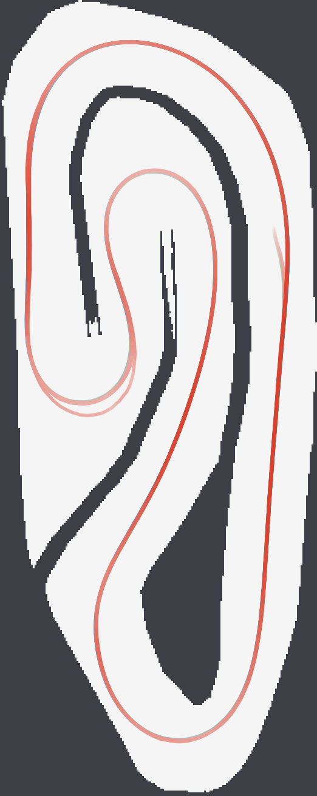

# RL pod

On the ICRA 2026 track in AutoDRIVE, our RL policy (P5) runs 10 laps with no wall contact at 11.52 s average. Pure pursuit on the same race line, at the fastest speed we could run it without crashing, averages 12.67 s. Results, video and how we got there are in [RESULTS.md](RESULTS.md).



## Read this first

The gym and AutoDRIVE disagree most at the grip limit, and RL drives at the limit. Before changing the env, the reward or the deploy node, read [env/AUTODRIVE_PHYSICS.md](env/AUTODRIVE_PHYSICS.md). It lists every AutoDRIVE limit that crashed one of our policies, with the evidence.

## Words we use

| Word | Meaning |
|---|---|
| pure pursuit | a classic path follower. It steers toward a point a little ahead on a given line |
| club line | the team's race line for the ICRA track, `env/tracks/icra/icra_line.csv`. The env plans a speed along it from the grip limit |
| x1.15 | every speed in that plan multiplied by 1.15. Pure pursuit was clean at x1.15 and crashed at x1.20 |
| residual policy | pure pursuit drives, and the policy only adds a small correction on top |
| P, P2 to P5 | our residual policies, in the order we built them. P4 and P5 are the two that worked in AutoDRIVE. Both leave steering to pure pursuit and correct only the throttle. P5 was trained on the newer slide model with the grip shield inside the gym |
| grip shield | a safety rule in the deploy node and the gym. It sets throttle to 0 while a corner asks for more grip than the car has |
| lateral demand | the sideways acceleration the car would need to follow its wheels, v² tan(wheel angle) / wheelbase, in m/s² |
| flying lap | any lap after lap 1. Lap 1 starts from standstill, so we compare the rest |
| simulator clock | AutoDRIVE's own time. It runs slower than real time and its speed changes, so lap times and control timing use it |
| nominal physics | the gym's best-fit AutoDRIVE values with no randomisation. Training randomises around them |

## What is where

| Folder | Owner | What is in it |
|---|---|---|
| [env/](env/) | Rubi | `race_env.py`, the gym env with AutoDRIVE's physics, its tests, and `validate_vs_autodrive.py`, which checks the gym against real AutoDRIVE runs. Track files are in `env/tracks/` |
| [train/](train/) | Nathaniel | `train.py`, `evaluate.py` and `export_policy.py` from the runs behind P5, as a starting point |
| [deploy/](deploy/) | Rishabh | the P5 policy file and the ROS 2 node that ran it in AutoDRIVE, with the pitfalls we hit |
| [policies/](policies/) | | other trained policies for comparison, now R (end to end, trained on an older env, crashes on today's) |
| [media/](media/) | | replay of the AutoDRIVE runs and training curves |

[STRATEGIES.md](STRATEGIES.md) has every approach we trained (end to end R, T, S, X and M, and residual P to P5), how the reward got from the whiteboard to v3, and the full training log.

`configs/` and `maps/` are empty placeholders from the pod scaffold.

## Quick start

Install the gym and training packages first (Setup in [train/README.md](train/README.md)). Then

```bash
cd pods/rl/env && python test_race_env.py          # the env works and matches its contract
python validate_vs_autodrive.py                    # gym vs AutoDRIVE, side by side
cd .. && python train/evaluate.py deploy/rl_policy_P5.npz
```

Running the policy in AutoDRIVE is in [deploy/README.md](deploy/README.md).
