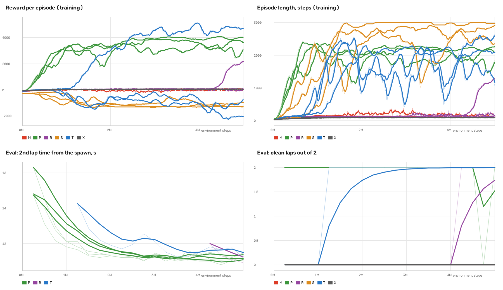
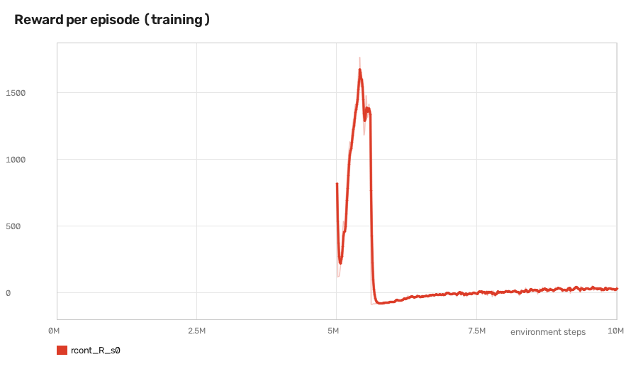

# Strategies we tried, and how the reward got to v3

This page records every training approach we ran on the ICRA track, the reward each one used and what happened, so nobody has to rerun them to find out. Terms are explained in [README.md](README.md#words-we-use). The numbers here are from the gym unless a line says AutoDRIVE. The AutoDRIVE results are in [RESULTS.md](RESULTS.md).

## The reward the deployed policy uses

The policy makes one decision every 0.05 s (one step), and every step gets a score. Summing the steps of a lap gives what that lap is worth. P5 uses reward v3, which scores five things each step.

| Term | Per step | Over one lap | What it is for |
|---|---|---|---|
| progress | +10 × metres gained along the centre line this step | +583 (the centre line is 58.3 m) | moving forward |
| time | -1 every step | -20 × lap time in seconds | going fast |
| lap bonus | +50 on the step that crosses the finish line | +50 | finishing laps |
| crash | -100, and the episode ends | 0 if clean | not hitting walls |
| steering change | -0.1 × change in the steering command since the last step | about -2 | no wobble |

### Why -1 per step is the time penalty

There are 20 steps per second, so every extra second costs 20 points, and a lap is worth 583 + 50 - 20 × lap time. P5's 11.5 s lap scores about 403 and pure pursuit's 12.67 s lap about 380. Every second faster is worth 20 points, so the reward points straight at lap time.

The net score per step is 10 × speed × 0.05 - 1, which is 0.5 × speed - 1. Above 2 m/s the car earns points, and standing still loses 1 point per step. So every stretch of track is compared against a 2 m/s reference speed. This is the whiteboard's lap time idea in a form RL can use. Rewarding "last lap time minus this lap time" directly would need a history the policy cannot see, which breaks the Markov property and turns the signal into noise.

Without a time term, a lap is worth 583 progress points whether it takes 8 s or 20 s. Speed then only matters through PPO's discount factor (points earned sooner count slightly more), and that push is weak.

### The lap bonus

On the step the car crosses the finish line it gets 50 points once. A crash ends the episode, so any lap that earns the 50 was clean. It tells the policy that a full lap is worth something. It is small next to the 583 progress points and does not change how P5 drives much. We kept it from the whiteboard reward.

### Why a crash costs 100

With a time penalty every step costs points, so a cheap crash could teach the policy to end the episode early and stop paying time. At -100 a crash is like being 5 s slower, and it also loses every lap after it, so crashing is the most expensive thing the car can do.

## How the reward got from the whiteboard to v3

1. The whiteboard reward (Oct 24 afternoon) was +10 × metres of progress, -0.05 × distance from the centre line, +50 per lap, and -10 for a crash that ends the episode. The whiteboard also had lap time × w2 and speed × w3. Lap time was left out because of the Markov problem above. Speed is in the env as the `speed` weight, off by default.
2. Training round 1 used the whiteboard reward for 1M steps. It lapped in 7.77 s in the gym by cornering at 50 m/s². That was a physics problem rather than a reward problem, so we added a 6 m/s² grip cap.
3. Round 2 still used the whiteboard reward. Laps went to 11.31 s, and it still cornered at 10 m/s² by drifting. Splitting one of its laps into reward terms gave +583 progress, +50 lap, -3 centre line, -1.7 steering change and -10 for a crash. Fast and slow laps scored almost the same, and a crash cost 10 points when a lap was worth 633.
4. Reward v3 (Oct 24 evening) was first used in round 3. It changed three weights and dropped one term.
   - Added the -1 per step time penalty.
   - Raised the crash penalty from 10 to 100.
   - Dropped the centre line penalty. The fastest way around uses the full track width, so that term works against it.
   - At the same time the env started treating a body slip over 15° as a crash, so the car cannot corner by drifting. The threshold comes from the TAL paper ([Evans et al. 2023](https://arxiv.org/abs/2306.07003)). It is an env rule, so it applies under both rewards.
5. The reward has not changed since. Everything after round 3 changed the physics. The env's default is still the whiteboard reward, the team's agreed default, and `train.py --preset p5` passes v3 as `{'time': 1.0, 'collision': 100.0, 'center': 0.0}`.

## The overnight sweep, six approaches

On Oct 25 we trained 6 approaches with 3 seeds each, 5M steps per run. The letters are labels. T stands for TAL, S for safe and P for pure pursuit, and R, X and M have no particular meaning.

| Label | Preset | What it is | Difference from v3 | Result |
|---|---|---|---|---|
| R | `r` | end to end, plain | none | 1 of 3 learned (10.94 s), and checkpoints next to its best one crashed |
| T | `t` | end to end with a reference line | each step adds up to 1 point the closer the action is to what pure pursuit would do right now (the TAL method) | 1 of 3 learned (11.30 s), the other 2 learned to stand still |
| S | `s` | end to end, safe | crash -300, time -0.5 per step, grip cap 7.5 | all 3 learned to stand still |
| X | `x` | end to end, aggressive | crash -50, time -1.5 per step | all 3 kept crashing |
| M | `m` | end to end, smooth steering | steering change penalty 0.5 instead of 0.1 | all 3 kept crashing |
| P | `p` | residual on pure pursuit | none. The policy corrects steering and throttle, scaled by 0.4 | all 3 learned (10.93 s) |

End to end means the policy drives straight from LiDAR and speed to steering and throttle, with nothing underneath it. Residual means pure pursuit drives and the policy adds a correction on top.

Our guesses for the failures, none of which we checked in detail. S stood still because a crash cost 300 while standing still cost 0.5 per step, and the discount factor makes far-off penalties look small, so not moving looked cheaper than risking a corner. X may be the reverse, with cheap crashes and expensive time, so it rushed. M may have turned in too late, since every steering change cost points.



Top left is the reward per episode during training and bottom right the clean laps in a periodic 2-lap test. The three green P runs climb within about 1M steps and stay there. One blue T run climbs after about 1M. One purple R run only starts to climb after about 4M. S, X and M stay near zero or below.

### R trained longer

We continued the one R seed that learned for another 5M steps with the same reward. By then the env had gained the 18° understeer (the car barely turns past 18°), so the physics also got harder at the restart. Its reward rose to about 1,700 at 5.4M, collapsed at 5.8M and stayed near zero. Its best checkpoint (5.25M) drove 5 clean laps out of 60 in our test and crashed in all 3 drives, and every checkpoint from 5.8M on crashed in the periodic test. Part of the drop may come from the new physics, so this does not prove R can never converge. It does show R did not adapt to the harder physics in 5M more steps, while P2, trained from scratch on that same physics, learned on all 3 seeds.



### What these results do and do not show

The sweep ran on an earlier version of the env, with a grip cap of 8.5 m/s² and none of the slide physics in [env/AUTODRIVE_PHYSICS.md](env/AUTODRIVE_PHYSICS.md). The R policy from the sweep is in [policies/](policies/). On today's env it crashes in its first lap. The presets rebuild the same rewards on today's env, but nobody has rerun them yet, so results on today's physics may differ. A fair R vs P comparison on the current physics is still open. S also lowered the grip cap to 7.5, which has no equivalent in today's slide model, so the `s` preset keeps only its reward.

## After the sweep, P2 to P5

P was the only approach that learned reliably, so the rest built on it. Each step fixed what the one before it crashed on in AutoDRIVE.

| Policy | What changed | Gym | AutoDRIVE |
|---|---|---|---|
| P | the sweep's residual, steering and throttle | 10.93 s | crashed, full lock in the hairpin |
| P2 | the gym's car barely turns past 18° | 11.11 s | crashed in lap 1 |
| P3 | randomised physics, correction scaled by 0.25 | 12.01 s | hit the wall at the hairpin, steering near 23° |
| P4 | slide model. 3 seeds throttle only, 3 seeds with ±3° of steering | 11.34 to 12.40 s | throttle only 10/10 clean at 11.59 s with the grip shield. The steering version slid in lap 3 |
| P5 | slide limit by wheel angle and time, grip shield inside the gym, throttle only | 11.26 to 11.42 s | 10/10 clean at 11.52 s |

## Every training run

One run starts from a random network and trains to a set number of steps. Two runs instead continued an earlier result, as noted.

| Round | When (2026) | Runs × steps | Training time | What it tested |
|---|---|---|---|---|
| 1 | Oct 24, 14:40 | 1 × 1M | about 18 min | whiteboard reward, plain gym |
| 2 | Oct 24, 15:07 | 1 × 1M | about 5 min | 6 m/s² grip cap |
| 3 (experiment A) | Oct 24, 23:30 | 3 × 3M | about 30 min | first use of v3, end to end |
| overnight sweep | Oct 25, 00:40 to 05:30 | 18 × 5M | about 5 h | R, T, S, X, M and P, 3 seeds each |
| P2 | Oct 25, 09:25 | 3 × 5M | about 50 min | P plus the 18° understeer |
| P3 | Oct 25, 11:00 | 3 × 5M | about 50 min | randomised physics |
| P4 and R continued | Oct 25, 20:47 to 23:36 | 6 × 8M, plus R trained 5M more | about 3 h | throttle only vs ±3° steering |
| P5 | Oct 26, 13:23 to 14:46 | 2 × 8M, plus 1 continued 4M from P4 | about 1.5 h | the current env with the grip shield |

That is 39 runs, about 200M steps and about 12 hours of training between Oct 24 and Oct 26. Usually 3 runs trained in parallel on one laptop, at 5 to 10 minutes per 1M steps. Two more launches were stopped within 20 minutes because their physics settings were wrong, and are not counted.

## Rerun any of them

```bash
cd pods/rl
python train/train.py --preset r --steps 5000000 --seed 0 --name r_s0
python train/evaluate.py train/runs/r_s0/final.zip
```

Swap `r` for `t`, `s`, `x`, `m`, `p` or `p5`. `--cfg` adds to a preset, so `--preset r --cfg '{"reward_weights": {"tal": 0.5}}'` is R with half the TAL term. Setup and checkpoint advice are in [train/README.md](train/README.md).
