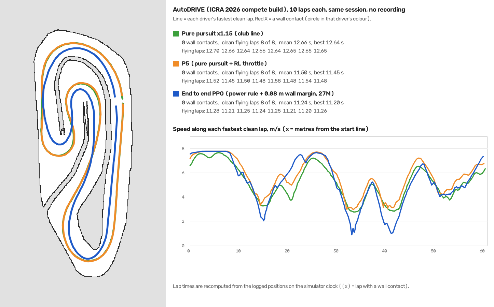
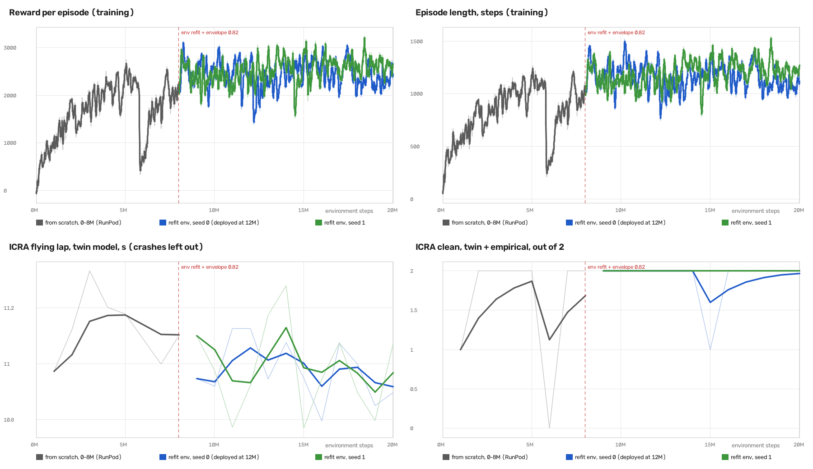
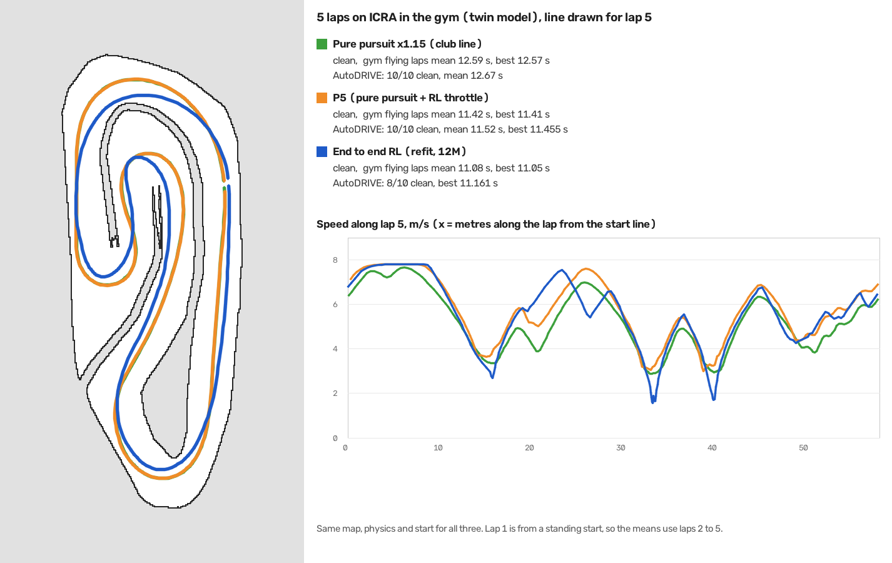

# Other policies

`rl_policy_R.npz` is R, the one end to end policy that learned in our overnight sweep ([../STRATEGIES.md](../STRATEGIES.md)). The policy sets steering and throttle itself from LiDAR and speed, with no pure pursuit underneath. It is here so anyone can run it or compare against it without retraining. It is not a working driver for AutoDRIVE.

| | |
|---|---|
| Training | PPO, reward v3, 5M steps, seed 0 |
| Env it was trained on | an earlier version with a grip cap of 8.5 m/s² and none of the slide physics in [../env/AUTODRIVE_PHYSICS.md](../env/AUTODRIVE_PHYSICS.md) |
| On that env | 60 of 60 clean laps, 10.94 s average, best 10.65 s |
| On today's env | crashes in its first lap on nominal physics, and in 27 of 30 randomised episodes |
| In AutoDRIVE | never run |

On today's env it asks for more than 18° of steering in 17 of its first 100 steps and sometimes uses full lock. The AutoDRIVE car barely turns past 18°, and the env now models that, so it runs wide and hits the wall about 23 m into its first lap.

The file has the same format as `../deploy/rl_policy_P5.npz`, so `../train/evaluate.py` and the deploy node can run it. Its `residual` is 0, so the node runs it end to end.

```bash
cd pods/rl && python train/evaluate.py policies/rl_policy_R.npz
```

To try it in AutoDRIVE, copy it into `../deploy/` and run `python3 rl_deploy_node.py rl_policy_R.npz --laps 1 --tag R` as in [../deploy/README.md](../deploy/README.md). Add `--no-grip-shield` to run it exactly as trained. Expect it to hit the wall.

The file holds the actor network only (110 inputs, two hidden layers of 256, 2 outputs) as numpy arrays. That is enough to run it. Continuing its PPO training also needs the stable-baselines3 checkpoint, which is not in the repo. Ask Rubi for it.

## rl_policy_E2E_mu.npz

End to end PPO trained on Rishabh's env (branch `rl-pod-env`, commit 401e771). That env sets the gym's vehicle parameters to AutoDRIVE's values (mu 1.0, h 0.07354, steering limit 30°, a_max 5.2) and draws mu from 0.8 to 1.2 every step. It keeps that branch's 6 m/s² grip cap and the whiteboard reward.

| | |
|---|---|
| Training | PPO, 6 workers, whiteboard reward, checkpoint at 1.5M steps |
| In that env | 5 clean laps from each of 3 starts, flying laps 11.5 to 11.8 s |
| In AutoDRIVE | not run yet |

The same setup on the env from before Rishabh's two commits was still crashing at 1.8M steps.

Two things from training that the deploy node now repeats, read from this file.
- The env limits steering at speed to atan(6.0 × wheelbase / v²), so cornering stays under 6 m/s². The file carries `steer_lat_cap` 6.0, and the node clips steering the same way.
- The env's `s_min` is -0.4189 while `s_max` is 0.5236, so the policy never steered right past 24°. The file carries `steer_min` -0.8 and `steer_max` 1.0 in command units, and the node clips to them. This looks like a typo in the env and should be fixed before the next training.

Files without these fields (P5, R) drive exactly as before. Copy it into `../deploy/` (the folder mounted in the container) and run it like P5, with AutoDRIVE in the background.

```bash
python3 rl_deploy_node.py rl_policy_E2E_mu.npz --laps 3 --tag e2e_mu
```

To make it run on f1tenth_gym dev-humble (bdaec14), the env needed two local changes, not pushed. That gym takes vehicle parameters as a `VehicleParameters` inside the env config rather than a `params=` argument to `gym.make`, and `update_params` takes a `VehicleParameters`, not a dict.

## rl_policy_v2_s0_8M.npz

End to end PPO on env_v2 ([../env_v2/README.md](../env_v2/README.md)). LiDAR, speed and the last action go in, steering and throttle come out. There is no pure pursuit underneath and no race line in the input. It is the first end to end policy that has finished clean laps in AutoDRIVE.

| | |
|---|---|
| Training | `train_v2/train.py --preset e2e_v2 --seed 0 --gen 200 --holdout none --cfg '{"focus_track": "icra", "focus_share": 0.5}'`, 15 workers on a RunPod CPU pod, checkpoint at 8M steps |
| ICRA in training | half of all episodes run on ICRA as raced, the other half on 200 generated tracks plus practice, mirrored and reversed |
| Gates (`train_v2/evaluate.py`) | ICRA clean on both models, 11.11 s twin and 11.23 s empirical. Randomised physics 6/20 crashed with timing off and 4/20 with timing on (P5 6/20 and 13/20). Delay tolerance 70 ms. Unseen tracks 9/10 clean |
| In AutoDRIVE (Rubi's Mac) | 19 laps tried in seven runs, 11 clean, one full clean 3 lap run, fastest 10.797 s (P5 best 11.455). Most failures were spins in the corner before the start straight. After one spin it drove the track backwards for two laps (it only sees LiDAR and trained on reversed tracks too). The cause is in [../env_v2/README.md](../env_v2/README.md#refit-2026-11-01) |

The Mac was heavily loaded during the first runs (load average 130 to 218, 11 to 13 control steps per run more than 100 ms late), but the spins also happened at low load. Use `rl_policy_v2_refit_s0_12M.npz` below instead.

Checkpoints next to this one were much worse (6M crashed on ICRA, 10M and later failed the randomised gates). Training longer made it faster on ICRA and less robust, which is why 8M was picked.

To run it in AutoDRIVE, copy it into `../deploy/` and use the v2 node, with AutoDRIVE in the background. Grip shield is off by default because the policy was trained without it.

```bash
python3 tools/reset.py
python3 rl_deploy_node_v2.py rl_policy_v2_s0_8M.npz --laps 3 --tag v2_s0_8M
python3 rl_deploy_node_v2.py rl_policy_v2_s0_8M.npz --laps 10 --tag v2_s0_8M_10
```

The node prints late steps at the end. If there are more than a handful, the result says more about the machine than the policy. To watch it in the gym first, run `python3 train_v2/view_icra.py policies/rl_policy_v2_s0_8M.npz` from `pods/rl`.

## rl_policy_v2_margin_s1_27M.npz

The end to end policy to use. It continues `rl_policy_v2_refit_s0_12M` with two extra crash rules in training, no full throttle while turning hard and a 0.08 m wall margin around the car (see [../env_v2/README.md](../env_v2/README.md#power-rule-and-wall-margin-2026-11-02)).

| | |
|---|---|
| Training | refit 12M, then `--cfg '{"focus_track": "icra", "focus_share": 0.5, "power_lat": 8.0}'` to 19M (seed 1), then `--cfg '{"focus_track": "icra", "focus_share": 0.5, "power_lat": 8.0, "wall_margin": 0.08}'` to 27M (seed 1). Each stage 8M steps on a Mac (`--device mps`, 8 workers), about 1 h for two seeds |
| Gates | ICRA clean on both models, 11.19 s. Randomised physics 4/20 crashed with timing off and 1/20 with timing on. Delay tolerance 90 ms. Unseen tracks 10/10. `margin_gate.py` 0/2 nominal, 1/10 randomised |
| In AutoDRIVE (Rubi's Mac, 2026-11-02) | 31 of 31 laps clean in six runs, 0 wall contacts, 0 to 3 late steps per run. Closest the car's outline came to a wall 0.07 m, 99 % of the time more than 0.14 m (P5 and pure pursuit 0.15 m) |

The 10-lap test ran all three drivers in the same session without screen recording.

| AutoDRIVE, ICRA, 10 laps | Clean | Flying laps | Mean | Best |
|---|---|---|---|---|
| pure pursuit x1.15 | 10 / 10 | 12.64 to 12.70 s | 12.66 s | 12.64 s |
| P5 | 10 / 10 | 11.45 to 11.58 s | 11.50 s | 11.45 s |
| **this policy** | **10 / 10** | **11.20 to 11.28 s** | **11.24 s** | **11.20 s** |

Lap times are from the logged positions on the simulator clock (laps 2 to 9; the node's own times for laps 2 to 10 were 11.18 to 11.35 s). That is 0.26 s a lap (2.3 %) faster than P5 and 1.42 s (11.2 %) faster than pure pursuit. It takes a shorter line inside both long corners and slows more in the hairpins (down to 1 to 2 m/s) than P5, which follows the club line.



Video, 3 clean laps with AutoDRIVE's sidebar and timing panel: [../media/autodrive_e2e_margin_3laps.mp4](../media/autodrive_e2e_margin_3laps.mp4).

```bash
python3 tools/reset.py
python3 rl_deploy_node_v2.py rl_policy_v2_margin_s1_27M.npz --laps 10 --tag margin_10
```

Keep AutoDRIVE in the background while it drives (another app in front) and check that the ICRA 2026 build is the one open; the practice build spawns in the same place but is a different track.

## rl_policy_v2_refit_s0_12M.npz

The same end to end setup, continued from `rl_policy_v2_s0_8M` on the refit env_v2 (envelope 0.82 instead of 0.95, twin refit to AutoDRIVE replays, see [../env_v2/README.md](../env_v2/README.md#refit-2026-11-01)). Replaced by `rl_policy_v2_margin_s1_27M`.

| | |
|---|---|
| Training | `train_v2/train.py --resume <the 8M checkpoint> --device mps --seed 0 --workers 8 --steps 12000000 --preset e2e_v2 --gen 200 --holdout none --cfg '{"focus_track": "icra", "focus_share": 0.5}'` on a Mac (networks on the GPU), checkpoint at 12M steps (4M after the resume), two seeds in 77 minutes |
| Gates | ICRA clean on both models, 11.12 s. Randomised physics 0/20 crashed with timing off and 3/20 with timing on. Delay tolerance 90 ms. Unseen tracks 10/10. One of 2 checkpoints out of 24 that pass every gate |
| In AutoDRIVE (Rubi's Mac) | 18 laps tried in five runs, 11 clean, fastest clean lap 10.955 s. The first 3 lap run was all clean (11.918, 11.203 s); the next three 3 lap runs each touched the wall once or twice. 0 to 9 late steps per run (during the 9 a viewer app was open on the same Mac) |

| | old 8M | refit 12M |
|---|---|---|
| Clean laps in AutoDRIVE | 11 / 19 (58 %) | 11 / 18 (61 %) |
| Best clean lap | 10.797 s | 10.955 s |
| Where it fails | spins before the start straight | mostly on the start straight just after that corner (4 of 7 touches), also twice in the first left corner after the start line |

The old spin corner is clean now, but the clean share hardly moved. The touches moved to the start straight just after that corner, a different case (the car yaws right at 12 to 14 m/s² while the policy already steers left and brakes), not diagnosed yet. At the time P5 and pure pursuit x1.15 were the reliable drivers in AutoDRIVE (10/10 each). The touches turned out to be the policy riding 0 to 5 cm from the wall, fixed in `rl_policy_v2_margin_s1_27M` above.





The training curve is one history. From scratch to 8M it ran on RunPod on the env before the refit (reward climbs from 0 to about 2,500, with one collapse near 6M), the dashed line marks the switch to the refit env, and both seeds then hold at 2,000 to 3,000 while the ICRA lap falls from 11.25 to about 10.9 s.

The gym race puts the three drivers on the same map, physics and start, 5 laps each, with lag on. Flying laps (twin model) were pure pursuit x1.15 12.59 s, P5 11.42 s and this policy 11.08 s, all clean (empirical model 12.50, 11.28 and 11.10 s). Pure pursuit and P5 share the club line, since P5 only changes the throttle. This policy picks its own line, tighter on the long left and through the top left corner, and gains its time between 20 and 25 m and out of both hairpins.

```bash
python3 tools/reset.py
python3 rl_deploy_node_v2.py rl_policy_v2_refit_s0_12M.npz --laps 3 --tag refit_3
python3 rl_deploy_node_v2.py rl_policy_v2_refit_s0_12M.npz --laps 10 --tag refit_10
```
